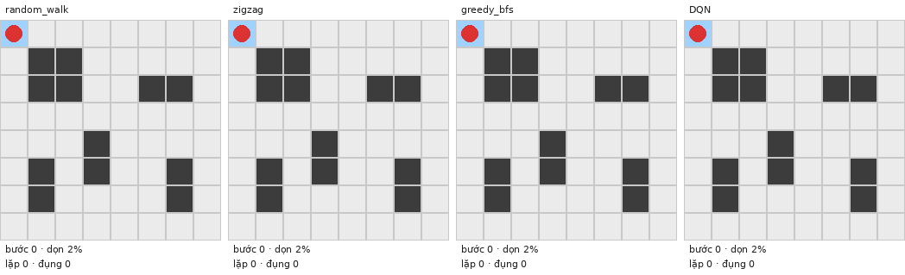

# Robot hút bụi phủ kín không gian bằng Học tăng cường

**REL301 – FA26 · hình thức Applications.** Dạy một robot hút bụi ảo tự học cách dọn hết căn phòng
dạng lưới với ít bước nhất, bằng **Q-learning** (phòng nhỏ) và **Deep Q-learning / DQN** (phòng lớn,
phòng chưa từng thấy). Kế hoạch: [PLAN_rel.md](PLAN_rel.md) (cái gì, vì sao) và
[IMPLEMENTATION_PLAN.md](IMPLEMENTATION_PLAN.md) (làm thế nào).



<!-- RESULTS_START -->
**Báo cáo đầy đủ (tiếng Việt):** mở [BAO_CAO_DU_AN.html](BAO_CAO_DU_AN.html) trong trình duyệt.

## Kết quả chính

Mọi số liệu: trung bình ± độ lệch chuẩn qua 5 seed (E3, E4: 3 seed), đo bằng chính sách tham lam.

| Thí nghiệm | Kết quả |
|---|---|
| Q-learning, phòng 3×3 và 4×4 (xuất phát cố định) | đúng số bước tối ưu ở mọi ô xuất phát (gap 0%); max Q(s0) hội tụ về đúng V* của Value Iteration |
| DQN, phòng 3×3 / 4×4 (xuất phát ngẫu nhiên) | 8,0 ± 0 / 12,72 ± 0,09 bước (tối ưu 8 / 12,69) |
| DQN, phòng 8×8 có đồ đạc | **51,9 ± 0,7 bước**, dọn xong 100% (greedy BFS 58,9; zigzag 80,0; cận dưới 51) |
| **DQN v4, 50 phòng 8×8 chưa từng thấy** | **98% ± 1% diện tích, dọn xong 80% ± 9%, 69,0 ± 1,5 bước khi xong** (greedy BFS 71,4; zigzag 80,8) |
| DQN v4, 50 phòng 6×6 chưa từng thấy (E4, huấn luyện vô hạn phòng) | 100% diện tích, dọn xong 99%, 33,8 bước (greedy BFS 38,8; zigzag 44,2) |
| E1: state thiếu bản đồ đã dọn | 0% dọn xong, 45% ± 22% diện tích (đủ thông tin: 100%, tối ưu) |
| E2: reward "hackable" | reward hacking ở cả 5 seed (dọn 92% rồi đi qua đi lại); shaping thế năng: 0/4.676 trạng thái đổi chính sách tối ưu |
| E3: phòng lạ 8×8 theo mật độ 0 / 10 / 20 / 30% | dọn xong 100 / 87 / 61 / 34%; phòng trống 63,7 bước (greedy 67,2) |
| E7: số trạng thái | 4×5: 1,4 triệu trạng thái đạt tới; 8×8: cận trên ~10²¹ |

Quá trình cải tiến DQN trên phòng lạ 8×8 (chi tiết trong `CHANGELOG_DESIGN.md`):
v2 14% diện tích → v3 (action masking) 37% → **v4 (quan sát lấy robot làm tâm + 16 môi trường song song + chọn mô hình theo tập kiểm định) 98%, dọn xong 80%**.
<!-- RESULTS_END -->

## 1. Bài toán

- **Ứng dụng:** robot hút bụi / lau sàn / máy cắt cỏ cần đi qua mọi ô của mặt bằng với quãng đường
  ngắn nhất (Coverage Path Planning). Tìm đường đi qua mọi ô ngắn nhất gần với bài toán đường đi
  Hamilton (NP-khó), nên không có công thức nhanh cho bản đồ lớn.
- **Môi trường** (`env/vacuum_env.py`, chuẩn Gymnasium): căn phòng là lưới `H x W`, ô `0` là sàn, ô `1`
  là đồ đạc/tường. Robot đi lên/xuống/trái/phải một ô mỗi bước; ô đi qua thành "đã dọn".

| Thành phần MDP | Định nghĩa |
|---|---|
| State | vị trí robot + tập ô đã dọn + bản đồ vật cản; với mạng nơ-ron là tensor `(3, H, W)` |
| Action | `0` lên, `1` xuống, `2` trái, `3` phải |
| Reward (dense) | ô mới `+1`, ô đã dọn `−0.1`, đụng tường `−0.5` (đứng yên), mỗi bước `−0.01`, dọn xong `+10` |
| Kết thúc | `terminated` khi dọn hết; `truncated` khi quá `4·|F|` bước |
| γ | `0.99` |

Vì sao state phải chứa **bản đồ đã dọn**: cùng một vị trí nhưng tiến độ khác nhau thì phần thưởng
tương lai khác nhau; bỏ nó đi là mất tính Markov (Sutton & Barto 2018, mục 3.1). Thí nghiệm E1 chứng minh.

## 2. Phương pháp

| Vai trò | Phương pháp | Giáo trình / nguồn | File |
|---|---|---|---|
| **Model chính** | Q-learning dạng bảng | Sutton & Barto 6.5 | `tabular/q_learning.py` |
| **Mở rộng của model chính** | DQN = Q-learning với mạng CNN thay bảng, replay buffer, target network | S&B 9, 11.3, 16.5; Mnih et al. 2015 | `deep/dqn.py` |
| Đáp án tối ưu (không học) | Value Iteration trên đồ thị trạng thái đạt tới được | S&B 4.4 | `tabular/value_iteration.py` |
| Baseline (không học) | đi ngẫu nhiên, zigzag, tham lam tới ô bẩn gần nhất | — | `baselines/` |

Đầu file `deep/dqn.py` có bảng đối chiếu từng dòng giữa Q-learning dạng bảng và DQN.

## 3. Cài đặt

Python 3.11–3.13. Mọi thứ cài trong `.venv` của thư mục dự án.

```powershell
python -m venv .venv
.\.venv\Scripts\Activate.ps1
python -m pip install --no-cache-dir --upgrade pip
# Máy có GPU NVIDIA: bản CUDA (đã kiểm chứng trên RTX 4050, driver CUDA 13):
pip install --no-cache-dir torch --index-url https://download.pytorch.org/whl/cu130
# Máy không có GPU: thay cu130 bằng cpu
pip install --no-cache-dir -r requirements.txt
```

Phiên bản đã kiểm chứng: `requirements-lock.txt`. Trên Colab: `pip install -r requirements.txt`.

## 4. Chạy test

```powershell
python -m pytest -m "not slow"   # ~15 giây
python -m pytest                 # đầy đủ, gồm chạy thử mọi script (~2-3 phút)
```

Test so khớp với đáp án tính tay: V\*(3×3, góc) = 16.968928…, số bước tối thiểu 8 / 9 / 8 (góc / giữa cạnh / tâm).

## 5. Tái lập thí nghiệm

Một lệnh cho tất cả (dừng ở bước đầu tiên bị lỗi):

```powershell
python -m experiments.reproduce_all --quick                # kiểm tra luồng, vài phút, ghi vào results/_quick/
python -m experiments.reproduce_all --full --workers 3     # chạy thật, nhiều giờ
```

Bộ nhớ: mỗi tiến trình huấn luyện DQN dùng ~0.8 GB RAM (CPU) hoặc ~1.4 GB (GPU). Với máy 16 GB RAM,
chạy tối đa ~5 tiến trình cùng lúc (`--workers`), không chạy nhiều lệnh `reproduce_all` song song.

```powershell
```

Hoặc từng thí nghiệm:

| Thí nghiệm | Lệnh | Kết quả chính | Thời gian (CPU 12 nhân) |
|---|---|---|---|
| Baseline | `python -m experiments.run_baselines` | `results/baselines/summary.csv` | < 1 phút |
| Đáp án tối ưu (VI) | `python -m experiments.run_value_iteration` | `results/vi/*_summary.csv` | < 1 phút |
| Q-learning | `python -m experiments.run_tabular --map obstacle_4x4 --start 0 0 --workers 5` | `results/tabular/figures/tabular_learning_curve_obstacle_4x4_s00.png`, `q_convergence_obstacle_4x4_s00.png` | ~3 phút |
| E7 + giới hạn tabular | `python -m experiments.run_state_explosion --workers 4` | `results/figures/state_explosion.png`, `tabular_scaling.png` | ~16 phút |
| E1 tính Markov | `python -m experiments.run_ablation --exp markov --workers 5` | `results/ablation/figures/e1_markov_obstacle_4x4.png`, GIF | ~3 phút |
| E2 thiết kế reward | `python -m experiments.run_ablation --exp reward --workers 5` | `results/ablation/figures/e2_reward_curves_obstacle_4x4.png`, GIF reward hacking | ~5 phút |
| DQN 3 bậc | `python -m experiments.run_deep --map obstacle_4x4 --timesteps 200000 --workers 5` (và `empty_3x3`, `furniture_8x8`) | `results/deep/dqn/*/summary.csv`, `results/deep/figures/` | 10–60 phút |
| DQN v4 phòng ngẫu nhiên | `python -m experiments.run_deep --random-maps 8 8 0.15 --timesteps 2000000 --n-envs 16 --batch-size 256 --train-freq 16 --action-mask --egocentric --keep-best --eval-every 50000 --eval-episodes 50 --workers 3` | `results/deep/dqn/rand8x8_d0.15_K0_mask_ego_ne16_bs256_tf16/` | ~1 giờ (GPU) |
| E3 mật độ vật cản (v4) | `python -m experiments.run_generalization --exp density --size 8 8 --timesteps 2000000 --n-envs 16 --batch-size 256 --train-freq 16 --action-mask --egocentric --keep-best --workers 4` | `results/generalization/figures/e3_density_8x8_mask_ego_ne16_bs256_tf16.png` | ~1,7 giờ (GPU) |
| E4 khái quát hóa (v4) | `python -m experiments.run_generalization --exp generalization --timesteps 2000000 --n-envs 16 --batch-size 256 --train-freq 16 --action-mask --egocentric --keep-best --workers 4` | `results/generalization/figures/e4_generalization_6x6_mask_ego_ne16_bs256_tf16.png` | ~1,5 giờ (GPU) |
| E6 khoảng cách tối ưu | `python -m experiments.run_optimality --workers 5` | `results/optimality/e6_optimality_gap.md` | ~30 phút |
| Demo | `python -m experiments.make_demo` | `results/demo/*.gif`, `demo_summary.md` | ~1 phút |

Mọi script có `--help`, `--seeds`, `--quick`, `--out`; mỗi thư mục kết quả có `config.json` ghi siêu tham
số, seed, commit git và phiên bản thư viện.

## 6. Demo

`python -m experiments.make_demo` tạo trong `results/demo/`:

- `compare_furniture_8x8.gif` — random / zigzag / greedy BFS / DQN đua trên cùng phòng 8×8.
- `compare_obstacle_4x4.gif` — thêm Q-learning và đường tối ưu của Value Iteration.
- `progress_qlearning.gif`, `progress_dqn.gif` — "robot học dần" qua các checkpoint.
- `heatmap_furniture_8x8.png` — ô nào bị đi lại nhiều (đỏ đậm = lãng phí).
- `unseen_rooms.gif` — DQN huấn luyện trên phòng ngẫu nhiên dọn 3 phòng chưa từng thấy.
- `demo_summary.md` — số liệu của các GIF để dán vào slide.

Xem nhanh môi trường với robot đi ngẫu nhiên (không cần mô hình):

```powershell
python -c "from env.render import demo_random_gif; demo_random_gif('furniture_8x8', 'results/gifs/random_8x8.gif')"
```

## 7. Cấu trúc thư mục

```
env/          môi trường: bản đồ, động lực học (transition thuần), render, wrapper
baselines/    random_walk, zigzag, greedy_bfs (giao diện Agent chung)
tabular/      đồ thị trạng thái, Value Iteration, Q-learning
deep/         CNN, replay buffer, DQN
experiments/  đánh giá, các script thí nghiệm, vẽ hình, demo, reproduce_all
tests/        pytest (đơn vị + chạy thử toàn bộ luồng)
results/      CSV, hình, GIF (mô hình .pt/.pkl không commit)
utils/        đường dẫn, seed, ghi file
```

## 8. Giới hạn

- Mô phỏng đơn giản hóa: robot đi từng ô, chuyển động tất định, không trượt bánh, không cảm biến nhiễu,
  không SLAM, vật cản tĩnh, một robot. Kết quả chưa chuyển trực tiếp sang robot thật (sim-to-real).
- Q-learning dạng bảng chỉ dùng cho một căn phòng và một điểm xuất phát cố định; bảng Q tăng theo hàm mũ.
- DQN tham lam tất định có thể lặp vòng tới hết số bước trên phòng khó: trên phòng lạ 8×8, 20% số lần
  chưa dọn xong; ở mật độ vật cản 30% chỉ dọn xong 34% (greedy BFS luôn dọn xong). Chúng tôi báo cáo cả
  các trường hợp đó, không chọn seed tốt nhất.
- Huấn luyện trên laptop (RTX 4050) nên DQN dừng ở 2 triệu bước; đường cong học vẫn còn đi lên.
- Mỗi mô hình DQN dùng cho một kích thước lưới cố định.

## 9. Cách nhóm dùng công cụ AI

Nhóm dùng Claude Code để viết code theo kế hoạch chi tiết (`IMPLEMENTATION_PLAN.md`). Mọi thuật toán
được đối chiếu với pseudocode Sutton & Barto (comment ghi số mục), kiểm chứng bằng test so với đáp án
Value Iteration và giá trị tính tay. Các thay đổi thiết kế được ghi trong `CHANGELOG_DESIGN.md`.
Mỗi thành viên chịu trách nhiệm giải thích phần code của mình khi vấn đáp.

## 10. Tài liệu tham khảo

- Sutton, R. S., & Barto, A. G. (2018). *Reinforcement Learning: An Introduction* (2nd ed.). MIT Press.
- Mnih, V. et al. (2015). Human-level control through deep reinforcement learning. *Nature*, 518.
- Ng, A. Y., Harada, D., & Russell, S. (1999). Policy invariance under reward transformations. *ICML*.
- Galceran, E., & Carreras, M. (2013). A survey on coverage path planning for robotics. *Robotics and Autonomous Systems*.
- Gymnasium documentation.
